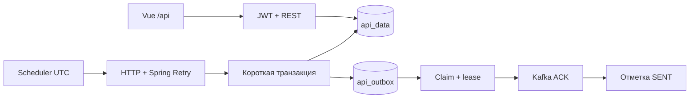

# Курс · API Monitoring Service

Spring Boot опрашивает Frankfurter v2 раз в минуту, сохраняет итог в PostgreSQL вместе с Transactional Outbox и доставляет снимок события в Kafka. Vue-интерфейс показывает статус сервиса пользователю и предоставляет администратору историю и CRUD.

## Запуск с нуля

Нужны Docker Engine / Docker Desktop с Compose v2, доступ к Docker Hub и Maven/npm registry, OpenSSL. Для проверки smoke — Python 3. Локальные порты: 8081 (UI), 8080 (backend), 5432 (PostgreSQL), 9092 (Kafka).

```sh
./scripts/init-env.sh
docker compose up --build
```

Откройте http://localhost:8081. Скрипт создаёт `.env` с независимыми случайными паролями и 256-битным JWT-ключом, не перезаписывая существующий файл. Логины — `user` и `admin`; пароли находятся в `DEMO_USER_PASSWORD` и `DEMO_ADMIN_PASSWORD` внутри локального `.env`. Файл исключён из Git. `.env.example` описывает поля.

- `USER`: только статус HTTP backend. Записи, количество и административные кнопки недоступны.
- `ADMIN`: статус, последние 10 записей, полное количество, создание, просмотр, изменение, удаление.
- Demo-аккаунты создаются только при профиле `local`. Пароли применяются при первом создании пользователя; изменение `.env` не меняет уже сохранённый BCrypt-хэш.
- Первый плановый опрос выполняется на следующей полной минуте UTC. Курсы Frankfurter обновляются ежедневно, одинаковые ответы сохраняются отдельными результатами.

Kafka не является зависимостью готовности backend. Если брокер отсутствует, backend принимает HTTP-запросы и накапливает outbox. При недоступной PostgreSQL запуск backend блокируется. Топики создаёт отдельный сервис `kafka-init`.

```sh
python3 scripts/smoke.py
docker compose logs -f backend
# Остановить, сохранив данные:
docker compose down
```

## Отдельный запуск

Нужны JDK **17**, Node **22.20.0**, npm 10+, запущенный Docker.

```sh
./scripts/init-env.sh
docker compose up -d postgres kafka kafka-init
set -a
. ./.env
set +a
cd backend
./mvnw spring-boot:run -Dspring-boot.run.profiles=local
```

Во втором терминале:

```sh
cd frontend
npm ci
npm run dev
```

Vite: http://localhost:5173. Оба proxy снимают `/api`: запрос UI `/api/data` приходит на backend как `/data`. `VITE_API_URL` по умолчанию `/api`; `API_PROXY_TARGET` меняет адрес backend для Vite. Для отдельного origin задайте `APP_CORS_ORIGINS` и согласуйте HTTPS/cookie-политику. Базовый режим — один origin.

## Архитектура



HTTP-запрос и backoff выполняются до транзакции. `ApiDataEntity` и outbox коммитятся вместе. Publisher захватывает одну запись с `FOR UPDATE SKIP LOCKED`, коммитит lease, отправляет вне транзакции и обновляет результат только при совпадении `lock_token`.

**Повторы:** Spring Retry делает **3 попытки всего**, включая первый запрос. Повторяются сетевые ошибки, таймауты, 408, 429 и 5xx. Обычные задержки 1 и 2 секунды. Некорректный JSON, пустые/неожидаемые данные, превышенный ответ и другие 4xx не повторяются. `Retry-After` учитывается; при слишком долгом ожидании текущий цикл заканчивается ошибкой, последующие обращения откладываются. Общий бюджет цикла — 50 секунд. Встроенные HTTP retry отключены.

Сбой внешнего API создаёт `success=false` и `api-errors`. Сбой БД не маскируется под результат опроса. Сбой Kafka оставляет неизменный результат и outbox для повторной доставки, не создавая `api-errors`.

## Авторизация и Swagger

Access JWT (HS256, issuer/audience/exp) живёт 15 минут и хранится только в памяти UI. Refresh — случайное непрозрачное значение, в БД только SHA-256, срок до 7 дней. Cookie `refresh`: HttpOnly, SameSite=Lax, host-only, Path=/; Secure по умолчанию, в `local` выключен для HTTP.

`GET /auth/csrf` выдаёт token/headerName и cookie. Auth POST требует соответствующий `X-XSRF-TOKEN`. После login/refresh/logout CSRF-cookie сбрасывается; UI получает новый токен перед следующим auth POST. CRUD принимает только Bearer, refresh-cookie не даёт доступа к `/data`.

Refresh ротируется атомарно с блокировкой строки. Использованный, отозванный или истёкший токен получает 401. **Политика повторного использования:** отклоняется предъявленный старый токен; другие токены пользователя и новая ветвь сессии автоматически не отзываются. Logout отзывает текущий refresh, удаляет cookie и очищает состояние UI. Уже выданный stateless access действует до истечения TTL.

Swagger UI в профиле `local`: http://localhost:8080/swagger-ui/index.html. Вне `local` OpenAPI и UI выключены и запрещены security-правилами.

1. Выполните `GET /auth/csrf` в Swagger, скопируйте `token`.
2. Вызовите `/auth/login`, указав токен в `X-XSRF-TOKEN` и demo-данные в JSON. Браузер сохраняет cookie.
3. Скопируйте `accessToken` в **Authorize → bearer** без префикса `Bearer`.
4. Перед refresh/logout снова вызовите `/auth/csrf`.

Подробный контракт: [docs/api.md](docs/api.md).

## Kafka и replay

Топики: `api-data` и `api-errors`, Kafka key — `dataId`.

```json
{"schemaVersion":1,"eventId":"UUID","dataId":"UUID","occurredAt":"2026-10-14T12:30:00Z","success":true,"payload":"исходное тело ответа"}
```

```sh
docker compose exec kafka /opt/kafka/bin/kafka-console-consumer.sh --bootstrap-server kafka:19092 --topic api-data --from-beginning --property print.key=true
docker compose exec kafka /opt/kafka/bin/kafka-console-consumer.sh --bootstrap-server kafka:19092 --topic api-errors --from-beginning --property print.key=true
```

Publisher делает до 20 попыток, backoff 5 секунд → максимум 5 минут, lease 60 секунд. После лимита состояние `FAILED`, без удаления снимка. После исправления причины повторите **конкретное** событие:

```sh
docker compose exec -T postgres psql -U monitor -d monitor -v event_id='НУЖНЫЙ-UUID' < scripts/replay.sql
```

EventId при replay сохраняется. Возможна повторная доставка, если Kafka приняла сообщение, а процесс упал до `SENT`. Idempotent producer не обеспечивает сквозное exactly-once между БД и Kafka. Потребитель должен устранять дубликаты по eventId. После длительного сбоя и исчерпания попыток нужен ручной replay.

Ручной CRUD не создаёт Kafka-событий. Изменение/удаление записи не меняет и не удаляет уже созданный снимок outbox. Poller рассчитан на один backend; несколько backend создадут несколько опросов за минуту. Publisher допускает конкуренцию благодаря lease и lock token.

## Проверки

```sh
cd backend
./mvnw --batch-mode clean verify
# Исправить форматирование:
./mvnw spotless:apply
```

`verify`: Checkstyle, Spotless, Surefire unit-тесты, Failsafe integration-тесты на настоящих PostgreSQL/Kafka через Testcontainers, общий JaCoCo с порогами 80% строк и ветвей. HTML: `backend/target/site/jacoco/index.html`. Docker и доступ к образам обязательны. Внешний API в тестах заменён MockWebServer; CI не обращается к Frankfurter.

```sh
cd frontend
npm ci
npm run lint
npm run format:check
npm run typecheck
npm test
npm run build
```

Vitest + Vue Test Utils, coverage 80% строк/ветвей (также функций/выражений); отчёт `frontend/coverage/index.html`. Бизнес-код и bootstrap входят в coverage. Сгенерированный Lombok-код фильтруется JaCoCo по аннотациям; ручных backend exclusions нет.

GitHub Actions повторяет эти проверки на push/PR и запускает Compose smoke после успешных backend/frontend jobs. [Ручной сценарий интерфейса](docs/manual-testing.md), [инструкция по проверкам](docs/verification.md).

## Версии и настройки

Java 17, Spring Boot 3.5.16 (Spring Security 6.5, Spring Framework 6.2), Springdoc 2.9.1, Maven Wrapper 3.9.16. Maven BOM фиксирует версии Spring Retry, Kafka, Hibernate, Liquibase, Lombok и Testcontainers. Vue 3.5.22, Vite 7.3.6, TypeScript 5.9.3, Axios 1.12.2, Vue Router 4.6.3, Pinia 2.0.34, Element Plus 2.9.4. Точные зависимости — `backend/pom.xml` и `frontend/package-lock.json`.

Образы зафиксированы в Compose/Dockerfile: PostgreSQL 17.6, Kafka 3.9.1, Nginx 1.28.0, Node 22.20.0, Temurin 17.0.16.

[Настройки](docs/configuration.md) · [Архитектурные решения](docs/architecture.md) · [API](docs/api.md)
